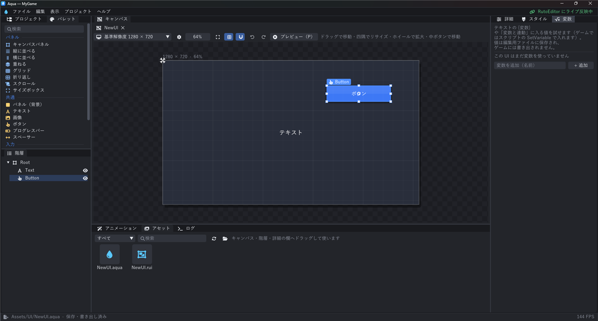

# Aqua

ゲームの UI（メニュー・HUD・設定画面など）のレイアウトを見たまま作るツール。
RutoEngine とは別のアプリで、**RutoEngine のプロジェクトが無くてもレイアウト単体で表示・編集できる**（レイアウトライブラリ）。
作ったレイアウトは `.aqua`（UI のバイナリ）として書き出され、RutoEngine に送ると `UIDocument` が表示する。



## 起動

**`Aqua.bat` をダブルクリック**すると Aqua が単独で開く（ようこそ画面から最近開いたもの・RutoLauncher のプロジェクトを選ぶか、フォルダ・レイアウトを開く。新しいライブラリも作れる）。

- まだビルドしていないとき、または Aqua のソース・RutoEngine の SDK が `bin\Aqua.exe` より新しいときは、先に自動でビルドしてから開く。
- ビルドに失敗しても前の `bin\Aqua.exe` があれば、それを開く。
- 引数はそのまま Aqua に渡る（例: `Aqua.bat --project D:\Games\MyGame`、`Aqua.bat D:\UI\MyLibrary\Body\Title.aqs`）。

ショートカットを作るなら `Aqua.bat` か、ビルド後の `bin\Aqua.exe` を指せばよい。

## ビルド

RutoEngine の SDK（ビルド済みのエンジン）をリンクして作る。先に RutoEngine の `Setup.bat` で SDK を作っておく。

**エンジンのパッチ**: キャプチャー・テキストアニメーション・UI のシェーダー・Null / Bounding ペイン・回転・頂点カラー・ユーザーデータ・パーツの上書き・アニメーションの区間・グループ・コマ送りは RutoEngine 側の実装が要る。**`ApplyEnginePatches.bat` をダブルクリック**すると、`EnginePatches` のパッチを番号の順に RutoEngine へ `git am` で当て、`Setup.bat` で SDK を作り直す。

- 当て済みのパッチは飛ばすので、何度実行してもよい（パッチが増えたときもこれを実行する）。
- RutoEngine にコミットしていない変更があると、パッチを当てる前に止まる（先にコミットするか stash する）。
- パッチが当たらなかったときは `git am --abort` で元に戻して止まる。
- `ApplyEnginePatches.bat --no-setup` でパッチだけ当てる（SDK は後で `Setup.bat`）。`--no-pause` で最後に止まらない。

手で当てるなら、RutoEngine のフォルダで次のようにする。

```bat
cd ..\RutoEngine
git am -3 ..\Aqua\EnginePatches\0001-UICapture.patch ..\Aqua\EnginePatches\0002-TextAnimation-UIShader.patch ..\Aqua\EnginePatches\0003-Fix-duplicate-glGetIntegerv.patch ..\Aqua\EnginePatches\0004-NullPane.patch ..\Aqua\EnginePatches\0005-Rotation-VertexColors-BoundingPane-UserData.patch ..\Aqua\EnginePatches\0006-PartOverrides.patch ..\Aqua\EnginePatches\0007-AnimSections-Groups-TextureFrames.patch
Setup.bat
```

パッチを当てていない SDK でビルドすると、「SDK が古い」というエラーで止まる。

```bat
build.bat                  :: release でビルドして bin\Aqua.exe に置く（= build.bat release install）
build.bat debug build      :: build\debug\bin\Aqua.exe（デバッグ用）
build.bat release run      :: ビルドして起動
build.bat debug clean
```

RutoEngine の場所は、環境変数 `RUTO_ENGINE_DIR` → このフォルダの隣の `..\RutoEngine` の順に探す。

```
MyProgram/
├─ RutoEngine/   エンジン（SDK/Debug・SDK/Release を Aqua がリンクする）
└─ Aqua/         このフォルダ
   ├─ Aqua.bat         Aqua を開く（必要ならビルドしてから）
   ├─ build.bat        ビルド
   ├─ ApplyEnginePatches.bat  RutoEngine にパッチを当てて SDK を作り直す
   ├─ Source/          Aqua のソース
   ├─ Resources/       アイコン（make_icon.py で作り直せる）
   ├─ Samples/         機能ごとの UI のサンプル（AquaSamples プロジェクト）
   ├─ build/           ビルドフォルダ（debug / release）
   └─ bin/Aqua.exe     build.bat install で置かれる Aqua
```

## サンプル

[`Samples/AquaSamples`](Samples/AquaSamples/README.md) は、Aqua の機能ごとの見本を集めた RutoEngine のプロジェクト。
文字アニメーション・会話ウィンドウ・UI シェーダー・キャプチャー・ウィジェットアニメーション・レイアウト・変数と入力・スタイルと部品の 8 つを、メニューから切り替えて試せる。

```bat
cd Samples\AquaSamples
build.bat release run                          :: ゲームとして動かす
..\..\Aqua.bat --project Samples\AquaSamples  :: Aqua で UI を開いて編集する
```

UI とシェーダーは `python Samples\generate_aqua_samples.py` で作り直せる（Aqua のコマンドライン import / export を使う）。

## レイアウトライブラリと Body / パーツ

Aqua は 2 種類のフォルダ（ワークスペース）を開ける。

| | ライブラリ | ゲームのプロジェクト |
|---|---|---|
| フォルダ | 好きなフォルダ（`aqua-library.json` が目印）。RutoEngine は要らない | RutoEngine のプロジェクト（`Assets` がある） |
| 編集用ファイル | `Body/*.aqs`・`Parts/*.aqs`（隣に `.aqua` を書き出す） | `AquaUI/*.aqs`（`Assets/UI/*.aqua` に書き出す） |
| 画像・フォント・シェーダー | ライブラリの中（`Images/`・`Fonts/`・`Shaders/` など）。パスはライブラリからの相対 | `Assets` の中 |
| RutoEngine への反映 | 「RutoEngine に送る」（下） | 編集するとすぐ反映（RutoEditor から開くとこちら） |

- **ファイルを 1 つだけ開いても使える**: `.aqs` / `.aqua` を開くと、それを含むライブラリ（`aqua-library.json` のあるフォルダ。無ければそのファイルのフォルダ。`Body` / `Parts` の中ならその親）を開く。
- 新しいライブラリは、ようこそ画面・「ファイル > 新しいライブラリ」で選んだフォルダに `Body`・`Parts`・`Images`・`Fonts`・`Shaders` を作る。

レイアウトには 2 つの種類がある（`.aqs` の `kind`）。

| 種類 | 使い方 |
|---|---|
| **Body** | 画面のいちばん親のレイアウト（タイトル・HUD・ポーズ画面など）。ゲームでは `UIDocument` に指定する。部品としては入れられない |
| **パーツ** | ほかのレイアウト（Body・パーツ）に部品（`UIUserWidget`）として入れて使い回すレイアウト（カード・ゲージ・ボタンの組など）。パーツを直すと、入れている所がすべて変わる |

- 「レイアウト」パネルは Body とパーツに分けて並ぶ。右クリックで「パーツにする / Body にする」。キャンバスの ⚙（レイアウトの設定）でも変えられる。
- パーツはパレットの「パーツ」の欄・レイアウトパネルからキャンバス / 階層へドラッグ（クリック）すると入る。Body・自分自身・入れ子が輪になるパーツは入れられない。
- パーツの「基準解像度」は、部品として入れたときの最初の大きさ（入れた先で変えられる）。
- **パーツの上書き**: 置いたパーツを選ぶと、詳細の下の「パーツの上書き」で中のウィジェットを選んで値を変えられる。変えた値はその置き場所だけに効き（`UIUserWidget` の `overrides`）、パーツの元の値と違うものだけを保存する。上書きしていない値は、パーツを直すとすべての置き場所に反映される。✕ やボタンで上書きを消すとパーツの値に戻る。
  スクリプトからは `ui->Find<UIUserWidget>("置いた名前")->SetOverride("中の名前", "text", "…")` / `ClearOverrides()`。

### RutoEngine に送る（ライブラリ）

右上の札（または「ライブラリ > RutoEngine に送る」）で、送り先のゲームのプロジェクトと、送り先のフォルダ（`Assets` の中。既定は `UI/ライブラリ名`）を選んで「送る」。

- Body・パーツを `Assets/<フォルダ>/` に書き出し、使っているパーツ・画像・フォント・音・シェーダーも一緒にコピーする。レイアウトの中のパスは送り先に合わせて書き換える（`Parts/Card.aqua` → `UI/MyLibrary/Parts/Card.aqua`）。
- スクリプト用のヘッダーも送り先の `Source/AquaGenerated/<フォルダ>/` に書く。
- 送り先はライブラリごとにユーザーの設定フォルダ（`%APPDATA%\Ruto\RutoEngine\Aqua\send-targets.json`）に覚え、ライブラリのファイルには書かない（ほかの人と共有しても、それぞれの送り先が使える）。
- 「編集するたびに送る」が入っていれば、以後は編集するたびに送り先へ書き出す（RutoEditor・実行中のゲームにすぐ反映）。

## RutoEngine との連携

- RutoEditor の .aqua のダブルクリック・UIDocument の「Aqua で開く」・「作成 > UI（Aqua で作る）」、RutoLauncher の「Aqua で UI を作る」で起動する。
- Aqua.exe の場所は、Aqua が起動するたびにユーザーの設定フォルダ（`%APPDATA%\Ruto\RutoEngine\Aqua\location.json`）に登録するので、どこに置いても見つかる。
  まだ一度も起動していなければ、RutoEngine の隣の `Aqua\bin`・`Aqua\build\release\bin`・`Aqua\build\debug\bin` を探す。環境変数 `AQUA_EXE` で直接指定もできる。
- 同じプロジェクトの Aqua は 1 つだけ起動し、エディターから開くと起動中の Aqua でそのファイルが開く（`build/Aqua` のロックと依頼のファイル）。
- **動的な反映**: 編集のたびに（ドラッグ中も 0.1 秒ごとに）`.aqua` を書き出し、エンジンはファイルの更新を見て読み直す。
  RutoEditor のシーンビュー・ゲームビュー・**プレイ中のゲーム**にそのまま反映され、部品（ユーザーウィジェット）を変えたときは使っている UI も作り直される。

## 画面

| 画面 | できること |
|---|---|
| レイアウト | Body とパーツの一覧・新規作成・複製・削除・種類の変更・RutoEngine に送る。以前の RutoEditor の UI デザイナーの `.rui` の取り込み |
| パレット・階層 | ドラッグで配置・並べ替え・親子付け、ラップ / 中身を取り出す、表示 / 非表示の切り替え、名前の変更（F2）。パレットの「パーツ」からパーツを部品として入れる |
| キャンバス | 見たままの編集。8 方向のリサイズ、**親・兄弟の端と中央への吸い付き**（Alt で無効、Ctrl で 10 刻み）、アンカー表示、解像度の切り替え、ホイールで拡大、プレビュー（P。実際に操作して確かめる） |
| 詳細・スタイル | スロット（アンカーのプリセット・余白・揃え・Auto / Fill）・プロパティ・スタイルの作成 / 反映 / 名前の変更 / 削除 |
| 変数 | テキストの `{変数}` や「変数と連動」に入る値を入れて見た目を確かめる（スライダーで 0〜1 も試せる） |
| アニメーション | ウィジェットアニメーションのタイムライン（録画・キーの移動・補間） |
| アセット | 画像・フォント・音・UI・シェーダーのサムネイル。キャンバスへドラッグ: 画像 → Image（画像・ボタン・枠に落とすと差し替え）、フォント → テキスト、音 → ボタンのクリック音、UI → 部品（ユーザーウィジェット）、シェーダー → そのウィジェットに掛ける |
| シェーダー | **UI のシェーダー（`.uishader`）を書く**。見本（グレースケール・セピア・白く光らせる・光が流れる・ディゾルブ・グラデーション・虹色・色相・点滅・走査線・ホログラム・ふちを暗く・波）から作る、書くと少し待ってコンパイル、エラーを行ごとに表示（クリックでその行へ）、コンパイルできたらすぐ保存してキャンバスに反映（書きながら反映）、`@param` を足す・消す・並べ替えてもウィジェットの値を名前で引き継ぐ |
| 整列 | **選んだウィジェットを自動で揃える・並べる**。左 / 中央 / 右・上 / 中央 / 下に揃える（選んだものの範囲・親・最初に選んだものに対して）、等間隔に並べる、決めた間隔で詰める、幅・高さを揃える、横一列 / 縦一列 / 格子（列の数・間隔・並べる順・置く場所・ます目の大きさ）。キャンバスで Shift + クリック・階層で Ctrl + クリックで一緒に選ぶ（まとめてドラッグもできる）。入れ物（Canvas Panel）だけを選ぶと、その子すべてが対象 |

### Null ペイン（パレットの「パネル」）

何も描かず、クリックも受け止めない入れ物（`UINullPane`）。子をまとめて動かす・拡大縮小する・アニメーションさせるための基準点にする。
子の置き方はキャンバスパネルと同じ（アンカーとピボット）。ゲームでは何も表示されず、キャンバスではデザイン中だけ四隅のかぎと基準点（ピボット）の十字で場所を示す。

- 例: ウィンドウの中身を Null ペインに入れ、Null ペインの `translation`・`renderScale`・`opacity` にキーを打つと、中身がまとめて登場する。

### 回転・頂点カラー・Bounding ペイン・ユーザーデータ

LayoutEditor 風の機能。どれも詳細の共通の欄（Bounding ペインはパレットの「パネル」）にあり、アニメーションでもキーを打てる。

| 機能 | 内容 |
|---|---|
| **回転** | `rotation`（度・時計回り）で描画を回す。子も一緒に回る。中心は `transformOrigin`（自分の中の割合。既定は中央 0.5, 0.5。描画の拡大の中心も同じ）。回したボタン・スライダーもそのまま操作でき、キャンバスでは回った枠を表示する。回した入れ物の「子を切り取る」は、回った四角形を囲む範囲で切り取る |
| **頂点カラー** | 「頂点カラーを使う」を入れると、左上・右上・左下・右下の色を混ぜて自分の描画（画像・背景・文字）に掛ける。子には掛からない |
| **Bounding ペイン** | 何も描かないクリックの範囲。押すと Click のイベント（クリック時のメッセージ。空なら名前）を出す。絵の一部をボタンにする・見えない当たり判定に。キャンバスでは薄いコーラル色で範囲を示す |
| **ユーザーデータ** | ウィジェットごとの自由な値。1 行に 1 つ「キー=値」で書き、スクリプトから `w->GetUserData("キー")` / `GetUserDataFloat("キー")` / `HasUserData("キー")` で読む |

UI のシェーダーの `LocalUV()` などは回っていない四角形を基準にするので、回したウィジェットでは模様が回らない。

### アニメーションの区間・グループ・コマ送り

| 機能 | 内容 |
|---|---|
| **区間** | アニメーションパネルの「区間」で、1 本のタイムラインに名前付きの範囲（In・Idle・Out など。繰り返しの設定つき）を付ける。目盛りに帯で表示する。スクリプトの `PlayAnimation("In")` は区間の名前でも再生でき、その範囲だけ動く |
| **グループ** | 「グループ」パネルで、選んだウィジェットをグループにまとめる（右クリックでメンバーを選ぶ・足す・外す・名前の変更）。アニメーションの「+ トラック」でグループを選ぶと、トラック `@グループ名` 1 本で全員が同じように動く。スクリプトからは `FindGroup("名前")`・`SetGroupVisible("名前", 表示)` |
| **コマ送り** | 画像の「コマの画像」に画像を 1 行に 1 つ書くと（「+ 画像をコマに足す」でも）、その中の「今のコマ」番目を描く。「今のコマ」にコンスタントのキーを打つとパラパラ漫画、「自動で送る速さ」を入れると自動で繰り返す |

区間・グループの名前もスクリプト用のヘッダー（`Animations`・`Groups`）に出る。

### キャプチャー（パレットの「共通」）

ゲームの画面をその場で撮って貼るウィジェット。ポーズ画面・メニューの背景に、止めたゲームの画面（ぼかし・暗くもできる）を出す。
撮った画面は **ゲームのメモリ（GPU のテクスチャ）に持つだけで、ファイルには保存しない**（UI を閉じると消える）。
置くと親いっぱいに広がり、一番奥に入る。

| プロパティ | 内容 |
|---|---|
| 撮るとき | 表示したときに撮る（止めた画面）/ 毎フレーム撮る（動く画面）/ スクリプトの `Capture()` で撮る |
| 撮る範囲 | 画面全体 / このウィジェットの後ろだけ（すりガラス風のパネル） |
| 色・ぼかし | 掛ける色（灰色で暗くする）・ぼかし（0〜1） |
| マウスを受け止める | 後ろの UI・ゲームにクリックを通さない |
| デザイン中の見本 | Aqua・RutoEditor のキャンバスで代わりに出す画像（ゲームでは使わない。無ければ模様）。プレビュー（P）では実際に撮る |

```cpp
// 撮り直す・撮った画面を使う
if (auto* c = dynamic_cast<UICapture*>(ui->Find(AquaUI::Pause::Widgets::Background))) {
    c->Capture();                                  // 次に描くときに撮り直す
    std::shared_ptr<Texture> tex = c->GetCapturedTexture(); // ほかの所でも使える
}
```

### テキストアニメーション（テキストの詳細の「アニメーション」）

| プロパティ | 内容 |
|---|---|
| 出し方 | すぐ全部 / 1 文字ずつ（タイプライター）/ ふわっと / ポップ / 下から浮かぶ / 上から落ちて弾む / 回りながら。速さ（文字 / 秒）・待ち時間・1 文字の時間 |
| 動き | 波 / 震え / 虹色 / 脈打つ / 揺れる / グリッチ。大きさ・速さ |
| 文字の音 | 文字を出すときに鳴らす音（会話の「ピピピ」）と、何文字ごとに鳴らすか |
| 自動で出す | オフにすると「出した割合」（0〜1）の分だけ出す。アニメーションのタイムラインで動かせる |
| タグ | 文字の中に `<wave>` `<shake>` `<rainbow>` `<pulse>` `<swing>` `<glitch>` `<color=#ff8800>` `<alpha=0.5>` `<pause=0.5>`（止める）`<speed=2>`（出す速さ）。詳細のボタンで、選んだ所をタグで囲める |

- 「テキストの演出（プリセット）」で、会話・ポップ・波打つタイトル・警告の震え・レアの虹色などをまとめて設定できる
- 編集中のキャンバスでは文字を全部出し（動きは見える）、プレビュー（P）とゲームで実際に出す
- 出し終えると `UIEventType::TextRevealed` のイベント（OnUIEvent）が来る

```cpp
ui->SkipText(AquaUI::Talk::Widgets::Message);          // すぐ全部出す（会話を送るとき）
if (!ui->IsTextRevealing(AquaUI::Talk::Widgets::Message)) NextLine();
ui->RestartText(AquaUI::Talk::Widgets::Message);       // 最初から出し直す
```

### UI のシェーダー（詳細の「シェーダー」）

どのウィジェットにも `.uishader` を掛けられる（子にも掛けるか選べる。入れ子にもできる）。`@param` の値は詳細でウィジェットごとに変えられ、アニメーションでも動かせる（ディゾルブの消える割合・光らせる量など）。
シェーダーがコンパイルできないときは、ふつうに描く。ファイルを書き換えると RutoEditor・実行中のゲームにもすぐ反映される。

```glsl
// @param strength float 0 1 1 強さ
// @param tint color 1 0.8 0.3 1 色
vec4 effect(vec4 color) {          // color はふだん描かれる色。返した色が描かれる
    float g = Luma(color.rgb);
    return vec4(mix(color.rgb, vec3(g) * tint.rgb, strength), color.a);
}
```

使えるもの: `uTime`・`LocalUV()`（ウィジェットの中の 0〜1）・`LocalPixel()`・`ScreenUV()`・`uRect`・`uScreenSize`・`SampleTexture(uv)`・`vUV`・`vColor`・`Luma`・`HueShift`・`Hash`・`Noise`。`@param` は `float` / `vec2` / `color` / `toggle`（最大 6 個）。

```cpp
ui->SetShaderParam(AquaUI::Title::Widgets::Logo, "progress", 0.5f); // @param を名前で変える
```

キー: Ctrl+Z / Ctrl+Y・Ctrl+C / V / X（別の UI・別の Aqua にも貼れる）・Ctrl+D・Delete・F2・矢印キー（1 ずつ、Shift で 10）・F（全体を表示）・G（グリッド）・P（プレビュー）・Shift + クリック（一緒に選ぶ）・Ctrl+S（保存して書き出す）・Ctrl+N / Ctrl+O / Ctrl+W・Ctrl+Shift+E（すべて書き出す）。
変更は自動で保存・書き出しされる。

## ゲームのプロジェクトに作られるファイル

| ファイル | 中身 |
|---|---|
| `AquaUI/*.aqs` | Aqua の編集用ファイル（XML。バージョン管理向け。ゲームには入らない。以前の JSON の `.aqs` も開け、開くと XML に書き直される） |
| `Assets/UI/Shaders/*.uishader` | UI のシェーダー（GLSL の effect() と @param。ゲームに入る） |
| `Assets/UI/*.aqua` | 書き出した UI のバイナリ（ゲームが読む。文字列表 + 型付きの値 + CRC。JSON と相互に変換でき情報は失われない） |
| `Source/AquaGenerated/**/*.h` | スクリプト用の名前の定数（ウィジェット・アニメーション・変数・ボタンのメッセージ）。書き間違いがコンパイルエラーになる |
| `ProjectSettings/Aqua.json` | Aqua の設定（書き出し先・ヘッダーを書き出すか・ライブで書き出すか） |

`.aqs` の XML は、UI の中身（`.aqua` と同じ木）を型の名前の要素で書いたもの。1 つの値は 1 行に収まる（改行・タブは `&#10;`・`&#9;`）ので差分が読みやすい。

```xml
<?xml version="1.0" encoding="UTF-8"?>
<AquaSource version="2" output="UI/Title.aqua" generator="Aqua 1.0.0">
  <object key="document">
    <object key="root">
      <string key="type">CanvasPanel</string>
      <bool key="visible">true</bool>
      <array key="children">
        ...
      </array>
    </object>
  </object>
  <object key="preview">
    <object key="variables">
      <string key="score">1200</string>
    </object>
  </object>
</AquaSource>
```

```cpp
#include "AquaGenerated/UI/Title.h"   // Aqua が書き出したヘッダー

auto* ui = GetEntity().GetComponent<UIDocument>();
ui->asset = AquaUI::Title::kAsset;                                   // "UI/Title.aqua"
ui->OnClick(AquaUI::Title::Widgets::StartButton, [] { SceneManager::LoadScene("Scenes/Stage1.rscene"); });
ui->SetVariable(AquaUI::Title::Variables::score, 1200);
ui->PlayAnimation(AquaUI::Title::Animations::FadeIn);
```

## コマンドライン

CI・ビルドの前処理向け（ウィンドウは出ない）。

```bat
Aqua.exe new-library D:\UI\MyLibrary              :: 新しいライブラリ（Body・Parts・Images・Fonts・Shaders）
Aqua.exe export D:\Games\MyGame                   :: すべてのレイアウトを書き出す（ライブラリのフォルダでもよい）
Aqua.exe export AquaUI\Title.aqs                  :: 1 つだけ書き出す
Aqua.exe import Assets\UI\Menu.rui --project .   :: 以前の .rui を取り込む（--part でパーツとして）
Aqua.exe send D:\UI\MyLibrary --to D:\Games\MyGame [--folder UI/MyLibrary]   :: ライブラリをすべて RutoEngine に送る（送り先を覚える）
Aqua.exe info Assets\UI\Title.aqua               :: バイナリの中身（情報・依存・文書）を JSON で見る
Aqua.exe to-json Assets\UI\Title.aqua out.json
Aqua.exe from-json Menu.json Assets\UI\Menu.aqua
Aqua.exe --project D:\Games\MyGame --open Assets\UI\Title.aqua
```

`.aqua` の形式と読み書きは RutoEngine の `Ruto::Aqua` モジュール（`Ruto/Aqua/AquaFormat.h`）にあり、エンジン・Aqua・ほかの道具で共通。
